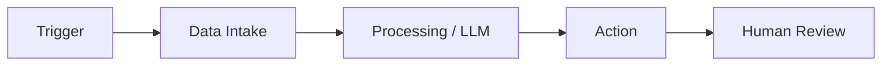

# Hi, I'm Emmanuel Kofi Mensah 👋

### AI Engineering Student · Workflow Automation · Python

**I build automations and AI workflows that save time and make processes clearer.**

---

## About

I'm an AI Engineering student at the University of Passau, Germany. I focus on workflow automation, APIs, and AI-powered tools. I'm looking for <working student / internship / thesis> opportunities in <field>.

## How I Build

## Selected Work

Projects coming soon. Currently building my first automation workflows.

## Toolkit

n8n · Power Automate

## Currently Learning

`n8n` · `Power Automate` · `API design` · `AI agents`

## Contact

[LinkedIn](<www.linkedin.com/in/emmanuel-kofi-mensah-b491b120b>) · [Email](mailto:<mensahemmanuel691@gmail.com>)
