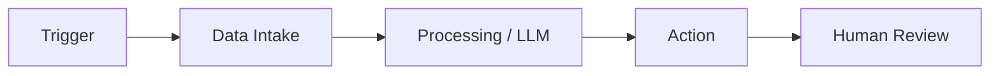

# Hi, I'm Emmanuel Kofi Mensah 👋

### AI Engineering Student · Workflow Automation · Python

**I build automations and AI workflows that save time and make processes clearer.**

[LinkedIn](https://www.linkedin.com/in/emmanuel-kofi-mensah-b491b120b)
[Email](mailto:mensahemmanuel691@gmail.com)

---

## About

I'm an AI Engineering student at the University of Passau, building automation workflows and AI-powered tools with n8n, Python, and APIs. I'm looking for working student and internship opportunities in AI and automation engineering, in Germany or remote.

## How I Build

## Selected Work

Projects coming soon. Currently building my first automation workflows.

## Toolkit

n8n · Power Automate

## Currently Learning

`n8n` · `Power Automate` · `API design` · `AI agents`

## Contact

[LinkedIn](https://www.linkedin.com/in/emmanuel-kofi-mensah-b491b120b) · [Email](mailto:mensahemmanuel691@gmail.com)
